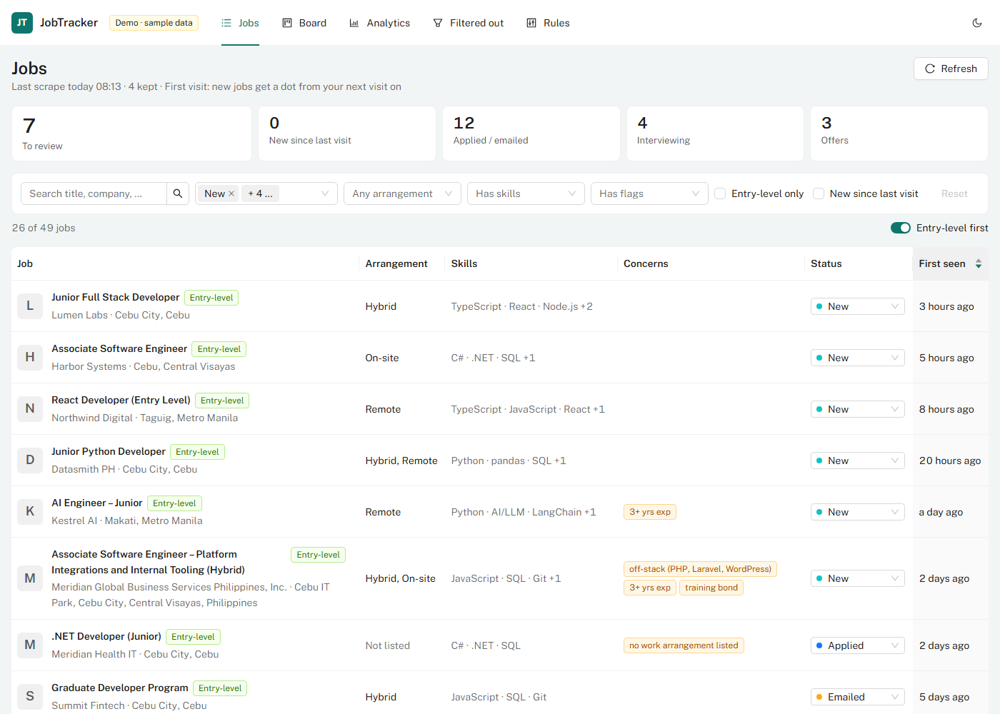
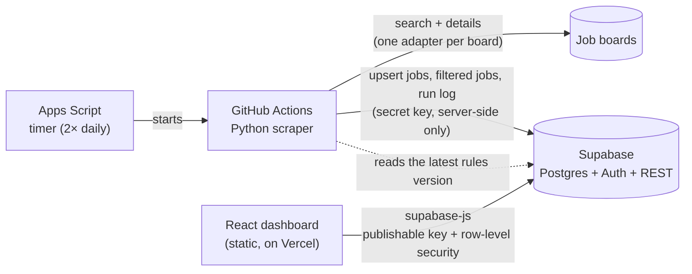
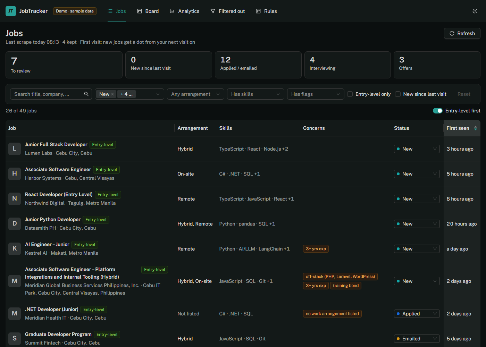
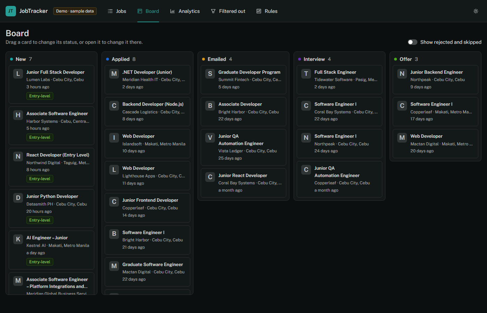
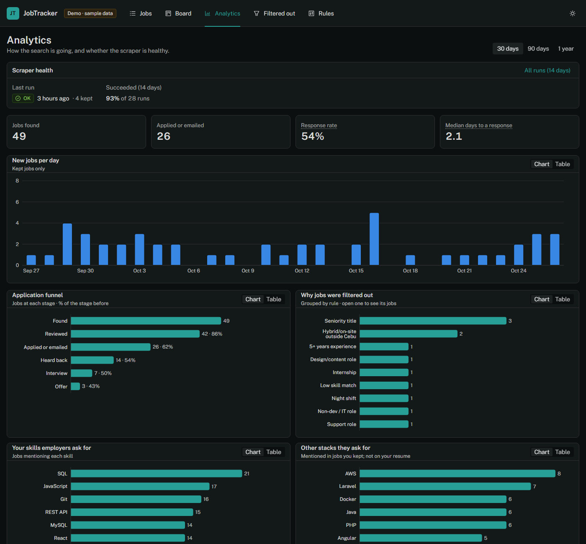
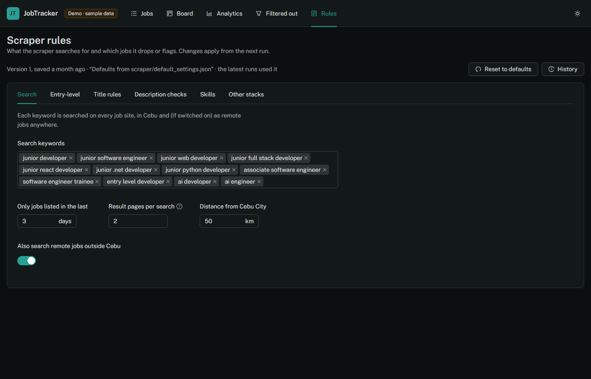

# JobTracker

A personal job-search pipeline: a scraper that collects listings from several job boards twice a day, filters and scores them against my own rules, and a dashboard where I review new listings, track applications and tune the rules.

**Live demo:** _link coming soon_ (sample data, no login; everything you change resets on reload)



## What it does

- **Collects and filters listings automatically.** Twice a day, the scraper searches each job board for my keywords, drops listings that don't fit (seniority titles, night shifts, too many years of experience, off-target roles…), scores the rest against my skills and flags things worth knowing (training bonds, "fresh grads welcome", stacks I don't use).
- **A daily review dashboard.**
  - Summary cards that double as one-click filters.
  - An "Entry-level first" ordering that floats junior, associate and trainee roles to the top.
  - Filters by status, skills, flags and work arrangement.
  - A detail drawer with the full description, notes, and a one-click Gmail draft for the application email.
- **Application tracking.** Statuses (applied, emailed, interview, offer, rejected, skip), a drag-and-drop kanban board, and a full status history.
- **Analytics.**
  - New jobs per day, the application funnel and response rate, and median days to a response.
  - Which of my skills employers ask for, and which other stacks keep coming up.
  - **Scraper health:** last runs, failures and interrupted runs, with a warning if nothing ran for a day.
- **Editable rules.** Search keywords, title exclusions, description checks, skill weights and more, edited in the dashboard as plain words, not regexes. Every save is a new version, with history and one-click restore. The next scraper run picks it up.
- **Auditable filtering.** Every dropped listing is kept with its reason, grouped by rule, so an over-strict rule is easy to spot and fix.

## How it works



- **No server to run.** The scraper runs on GitHub Actions, Supabase provides the database, auth and REST API, and the dashboard is a static site. Everything runs on free tiers.
- **Security is enforced by the database.** The browser only holds the publishable key. Postgres row-level security returns data only to accounts listed in an `app_users` table, and logged-in users can only change the columns they own (status, notes…). Anonymous requests get nothing.
- **The rules live in Postgres as append-only versions.** The scraper validates the newest version at startup and falls back to built-in defaults if it's missing or malformed, so a bad edit can't break a run. Rules are plain words and phrases that the scraper compiles into case-insensitive, whole-word patterns. The dashboard runs the same validation before saving, and uses a port of the same matcher for its "Entry-level" marker.

## Engineering notes

- **Migrated from a spreadsheet without downtime.** This started as a Google Sheets prototype. The scraper now writes to a list of outputs; during the move it wrote to the sheet and Postgres in parallel, and every output skips IDs it already has, so failed runs can simply be retried. The sheet's history was imported with a one-off script that never overwrites newer dashboard edits.
- **Rule changes are regression-tested.** The scraper's rules are covered by unit tests and a regression set of real listings I labelled by hand, so the rules can't silently start dropping jobs I wanted. When the hard-coded rules became editable settings, a side-by-side comparison on every real title confirmed the old and new rules behave the same.
- **Demo mode through the data layer.** Components never call Supabase directly. They use one `DataApi` interface with two implementations, Supabase and in-memory sample data, so the public demo is the same app built with a different flag.
- **Accessible and responsive.** Light and dark themes, keyboard navigation (including the kanban board), a phone layout for quick triage, and chart colours checked for contrast and colour-blind safety. Every chart can also be viewed as a table.
- **Tested in CI.** Every push runs the scraper's lint and tests (pytest, 129 tests) and the dashboard's lint, tests (Vitest + Testing Library, 108 tests) and production build.

## Tech stack

| Part | Tools |
|---|---|
| Scraper | Python 3.13, `requests`, Beautiful Soup, GitHub Actions (scheduled by a Google Apps Script timer) |
| Database & auth | Supabase: Postgres, row-level security, Auth, REST (PostgREST); SQL migrations via the Supabase CLI |
| Dashboard | React 19, TypeScript, Vite, Ant Design 6, TanStack Query, React Router, Recharts, dnd-kit |
| Testing & CI | pytest, ruff, Vitest, Testing Library, oxlint, GitHub Actions |
| Hosting | Vercel (static) |

## Screenshots

| | |
|---|---|
|  |  |
|  |  |

## Project structure

```
scraper/              Python scraper
  scraper.py            one run per job board: search → filter → score → write to the outputs
  rules.py              filtering, flagging and skill scoring, built from the settings
  settings.py           settings validation; defaults in default_settings.json
  sinks.py              outputs (Supabase REST, spreadsheet), run log, settings loading
  import_sheet.py       one-off import of the spreadsheet history
  tests/                unit, regression and integration tests (fake HTTP)
supabase/migrations/  schema, row-level security, triggers, settings versions
web/                  React dashboard
  src/data/             DataApi: Supabase and demo implementations, React Query hooks
  src/lib/              pure logic: filters, analytics, rule validation, entry-level matching
  src/pages/            Jobs, Board, Analytics, Filtered out, Rules
apps_script/          Apps Script: the twice-daily timer (and the original spreadsheet backend)
docs/                 setup guides and screenshots
```

## Running it locally

**The dashboard with sample data** needs no accounts or keys:

```bash
cd web
npm install
npm run dev:demo
```

**The full setup** needs a free Supabase project (run the migrations with `npx supabase db push`) and a few environment variables:
- **Dashboard:** `web/.env.example`, and [docs/DASHBOARD_SETUP.md](docs/DASHBOARD_SETUP.md) for creating the login and deploying.
- **Scraper:** `SUPABASE_URL` and `SUPABASE_SECRET_KEY` as GitHub Actions secrets. `python scraper.py --dry-run` runs it locally without writing anything.

**Tests:**

```bash
cd scraper && pip install -r requirements-dev.txt && ruff check . && pytest
```

```bash
cd web && npm run lint && npm test && npm run build
```

## A note on scraping

This is a personal tool for my own job search. It reads publicly listed jobs at low volume (two runs a day, with delays between requests) and is not meant for redistributing anyone's data. The public demo uses made-up sample data only. Check a site's terms before pointing a scraper at it.
